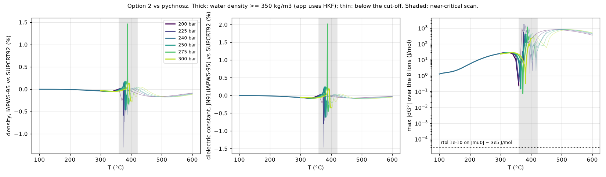

# Spike: water properties and HKF in Julia (plan section 4)

Question from `docs/spec/julia_migration_plan.md`, section 4: can option 2
(IAPWS-95 water density from Clapeyron, plus the dielectric constant, Born
functions and revised HKF written in Julia) replace pychnosz (SUPCRT92) within
the reference tolerance? If not, how far off is it, where, and what does
option 1 cost?

**Answer: no.** The Julia dielectric constant, Born functions, g-function and HKF
code reproduces pychnosz to machine precision when it gets SUPCRT92's density.
All of the remaining difference comes from the density: IAPWS-95 differs from
SUPCRT92's Haar–Gallagher–Kell / Levelt Sengers (HGK/LVS) water by 1e-4 to 6e-3
(relative) where the app uses HKF. That moves the ion standard Gibbs energies
by 1–40 J/mol below 350 °C and by up to ~500 J/mol (0.09 RT) near the critical
point. The reference tolerance is rtol 1e-10. The deviation also fails the
solve-level tests for cases that have ions.
**Recommendation: option 1. Get the density from SUPCRT92's own H2O92 routine
and keep the Julia JN91/Born/HKF code from this spike** (details at the end).

## 1. What the app uses from pychnosz

Only `src/htg/standard_states.py` calls pychnosz (through `htg.backends.chnosz`):

| Function | pychnosz call | Used for |
|---|---|---|
| `supcrt_water(T, P)` | `water(['rho','epsilon','QBorn','XBorn','YBorn','alpha','daldT','beta'], T, P)` (SUPCRT92, H2O92 Fortran) | `ElectrolytePhase.water` (`phases.py`). Only **rho** and **epsilon** affect results. rho feeds the validity check `rho >= 350 kg/m3 and epsilon > 1` (`phases.py`, `sweep.py`). epsilon is the solvent permittivity of the ePC-SAFT Debye–Hückel term (`hsdDH(..., ConstRSP(eps))`). The other six values are stored and compared by `test_electrolyte_phase` (`same(phase.water, ref['water'])`), but nothing else uses them. |
| `hkf_ion_g0(table, ions, T, P)` | `hkf(property=['G'], contrib=['n','s','o'], water_model='SUPCRT92')` | Ion standard chemical potentials `mu0_ion`, shifted from CHNOSZ's apparent-Gf anchor to the NASA Hf − T·S reference. For G, HKF needs epsilon(T,P), rho(T,P) (g-function), and epsilon and Y at 25 °C, 1 bar. |

The HKF parameters are **not** taken from pychnosz's OBIGT. The registry reads them
from `data/supcrt92.xml` (`registry.ion_hkf_table`), and `hkf_ion_g0` passes
them to pychnosz. There are 8 ions in the shipped databases, all charged:
Na+, K+, Cs+, Cl−, HCO3−, CO3²−, Li+, Mg²+. The electrolyte equation of state
always contains Na+, HCO3− and CO3²− (`[aqueous_reference]` in `species.toml`).
The example cases (`cases/manure_*.toml`, `yakaboylu2013_fig7_8.toml`) use all
8 ions at 240 bar and 100–390 °C. Their aqueous cut-offs are 380, 385 and 390 °C.
`cellulose_matlab.toml` uses the molecular aqueous model, so no HKF.

**Reference tolerance** (`tests/test_reference_thermo.py::test_electrolyte_phase`,
data in `tests/reference/data/thermo.json`):
- water: `same(...)`, rtol 1e-10
- `mu0_ion`: `close(...)`, rtol 1e-10, atol 1e-12. With |mu0| ~ 3e5 J/mol this allows ~3e-5 J/mol.
- `lnphi_infinity`, ln phi: rtol 1e-9
- G: rel 1e-10

Electrolyte states in `thermo.json`: 200 °C/240 bar, 300 °C/240 bar, 350 °C/250 bar.
Solve level (`test_reference_solves.py`): G rel 1e-9, amounts rtol 1e-5 /
atol 1e-7, gas carbon fraction abs 1e-7.

## 2. Method

Files in this folder:

| File | What it does |
|---|---|
| `hkf_water.jl` | Option 2. Density from `Clapeyron.IAPWS95()` (v0.6.30, as pinned in `src/htg/juliapkg.json`). alpha, beta and dalpha/dT come from AD: two Dual-number Newton steps on Clapeyron's `pressure(V, T)`, starting from the converged volume. JN91 dielectric constant; Born Q, Y, X; Shock et al. (1992) g-function; revised HKF G. All in SUPCRT92/CHNOSZ units and conventions, including the NASA reference shift that `hkf_ion_g0` applies. |
| `dump_pychnosz.py` | Writes `pychnosz_reference.json`: the app's own `supcrt_water` and `hkf_ion_g0` on the grid, with HKF records read through the app's registry from `data/supcrt92.xml`. |
| `compare.jl` | Computes, for every grid point: (a) **implementation check**, the Julia code fed with SUPCRT92's rho, alpha, beta and dalpha/dT; (b) **option 2**, everything from IAPWS-95; (c) option 2 but with SUPCRT92's epsilon and Y at 25 °C/1 bar kept as constants. Writes `julia_results.json`. |
| `analyse.py` | Tables below, `deviations.csv`, `deviations.png`. |
| `impact.py` | Patches option-2 water properties and ion G into the current Python app (lookup by T, P), then reruns the electrolyte phase checks and the electrolyte reference solves against `tests/reference/data`. |

Grid, 486 points in total:
- the plan grid, 300–600 °C × 200–300 bar in 10 °C × 25 bar steps;
- 100–390 °C every 5 °C at 240 bar, plus 389.6 °C;
- a near-critical scan, 360–420 °C every 1 °C at 225, 240, 250, 275 and 300 bar;
- the `thermo.json` states.

Run (from the repository root; julia_results.json and deviations.csv are not committed):

```
uv run python julia/spikes/hkf_water/dump_pychnosz.py
julia --project=julia/spikes/hkf_water julia/spikes/hkf_water/compare.jl
uv run python julia/spikes/hkf_water/analyse.py
uv run python julia/spikes/hkf_water/impact.py      # ~2 min, loads the app's Julia
```

The Julia side evaluates all 486 points in 0.15 s on one thread, after compilation.

## 3. Results

### 3.1 The Julia formulas reproduce SUPCRT92 exactly

With SUPCRT92's density, alpha, beta and dalpha/dT as input:

| quantity | max rel deviation |
|---|---|
| epsilon (JN91) | 1.6e-16 |
| Q, Y | 9e-16 |
| X | 2e-14 |
| mu0_ion, all 8 ions | ≤ 1.4e-13 rel, ≤ 2.3e-10 J/mol |

All of these are inside the reference tolerance. One detail is needed to get there.
SUPCRT92's `JN91` has the coefficients in a Fortran `DATA` statement as
single-precision literals (`0.1470333593E+02`). SUPCRT92 therefore uses their
Float32 values. With the full decimal values, epsilon is off by ~1e-7. `hkf_water.jl`
rounds them to Float32 the same way.

So **the only source of disagreement is the water density, together with its T and P
derivatives.**

### 3.2 Option 2 (IAPWS-95) vs pychnosz

"Where the app uses HKF" means SUPCRT92 rho ≥ 350 kg/m3. The app refuses the
electrolyte model below that. The ion columns show option 2 with all water
properties from IAPWS-95. Keeping SUPCRT92's 25 °C constants (epsilon_r, Y_r)
lowers the medians by about half and leaves the maxima unchanged; see
`analyse.py` output. dG/RT is the error in ln K per unit of reaction coefficient.

**Water, max |rel| deviation (median in brackets)**

| region | rho | epsilon | Q | Y | X | alpha | beta | dalpha/dT |
|---|---|---|---|---|---|---|---|---|
| 100–350 °C, 240 bar | 5.2e-4 (1.6e-4) | 7.8e-4 (2.3e-4) | 3.5e-3 | 1.8e-3 | 1.1e-2 | 3.0e-3 | 4.1e-3 | 1.5e-2 |
| 355–390 °C, 240 bar, rho ≥ 350 | 4.6e-3 (2.8e-4) | 6.1e-3 (4.1e-4) | 4.0e-2 | 3.9e-2 | 1.0e-1 | 3.7e-2 | 3.7e-2 | 1.2e-1 |
| plan grid, rho ≥ 350 (n = 45) | 3.4e-3 (4.5e-4) | 4.5e-3 (6.7e-4) | 1.7e-2 | 1.2e-2 | 1.2e-1 | 1.1e-2 | 1.5e-2 | 1.7e-1 |
| near-critical scan, rho ≥ 350, without the 3 non-converged SUPCRT92 points (see 3.3) | 5.8e-3 (2.7e-4) | 8.0e-3 (3.9e-4) | 6.6e-2 | 5.8e-2 | 1.3e-1 | 5.2e-2 | 5.9e-2 | 1.7e-1 |
| plan grid, all (incl. rho < 350, not used by the app) | 5.8e-3 (1.1e-3) | 5.4e-3 (6.4e-4) | 2.7e-2 | 3.1e-2 | 1.2e-1 | 3.4e-2 | 2.8e-2 | 1.7e-1 |

**Ion mu0, max |dG| in J/mol (median in brackets); the worst ion is named**

| region | Na+ | K+ | Cs+ | Cl− | HCO3− | CO3²− | Li+ | Mg²+ | worst dG/RT |
|---|---|---|---|---|---|---|---|---|---|
| 100–350 °C, 240 bar | 2.9 (1.6) | 1.8 (1.0) | 1.0 (0.5) | 21 (7.6) | 20 (6.7) | 41 (18) | 3.9 (2.2) | 11 (5.6) | 8e-3 (CO3²−, 330 °C) |
| 355–390 °C, 240 bar, rho ≥ 350 | 28 (2.2) | 6.6 (1.0) | 0.8 (0.4) | 182 (7.7) | 214 (7.9) | 195 (14) | 71 (4.0) | 406 (18) | 0.075 (Mg²+, 380 °C) |
| plan grid, rho ≥ 350 | 18 (2.6) | 3.6 (1.7) | 2.1 (0.9) | 139 (19) | 161 (17) | 184 (37) | 47 (3.3) | 275 (6.6) | 0.050 (Mg²+, 390 °C/275 bar) |
| near-critical scan, rho ≥ 350, without non-converged points | 38 (1.9) | 11 (1.0) | 2.1 (0.4) | 202 (11) | 243 (11) | 202 (18) | 92 (3.3) | 503 (14) | 0.093 (Mg²+, 375 °C/225 bar) |
| plan grid, all (incl. rho < 350) | 106 (48) | 76 (29) | 43 (15) | 800 (198) | 766 (175) | 1530 (463) | 128 (71) | 402 (200) | 0.28 (CO3²−, 380 °C/225 bar) |

At the reference states, max rel deviation of mu0_ion against the rtol of 1e-10:
2.0e-5 at 200 °C, 5.9e-5 at 300 °C, 6.1e-5 at 350 °C.

What drives the deviation:
- **Density.** HGK and IAPWS-95 differ by 1e-4 to 5e-4 in the compressed liquid and by up to
  ~0.5 % around the pseudo-critical line, where SUPCRT92 switches to the LVS equation.
- **epsilon follows density.** In JN91, d ln epsilon / d ln rho ≈ 1.4.
- **Charge.** The HKF solvation term is −omega(1 − 1/epsilon). Its sensitivity grows with
  omega and Z², so the deviation ranks Mg²+ and CO3²− > Cl− and HCO3− > Na+ and Li+ > K+ > Cs+.
- **Derivatives are worse.** Q, Y, X, alpha, beta and dalpha/dT deviate 1–17 %. They do not enter G, but
  they are part of the `water` dict the reference test compares.
- **25 °C anchor.** IAPWS-95 at 25 °C, 1 bar differs from SUPCRT92 by −1.4e-5 in rho,
  −1.6e-5 in epsilon and −5e-4 in Y. That adds up to ~25 J/mol at 600 °C; keeping SUPCRT92's
  constants removes it, as noted above.
- **Cut-off.** The 350 kg/m3 crossing moves by only 0.01–0.07 °C, for example 380.66 → 380.65 °C at 240 bar.
  None of the case temperatures changes side.



### 3.3 The near-critical region and a SUPCRT92 defect

SUPCRT92's LVS density solver (`denLVS`: 20 Newton steps, tolerance 1e-6) does
not converge in bands about 0.5 °C wide on each side of the pseudo-critical
line. There it returns a fixed density of **420.04** or **199.78 kg/m3**, so the
returned state is up to ~2 bar off the requested pressure (density error up to ~3 %).
The result is deterministic: it does not depend on earlier calls. Scanning in
0.05 °C steps found these bands:

| P (bar) | rho = 420.04 band (used by the app) | rho = 199.78 band (below the cut-off) |
|---|---|---|
| 225 | 374.60–374.80 °C | 378.05–378.40 °C |
| 240 | **378.55–379.00 °C** | 386.45–386.90 °C |
| 250 | 381.15–381.75 °C | 392.10–392.60 °C |
| 275 | 387.75–388.45 °C | 406.55–406.85 °C |
| 300 | 394.30–395.05 °C | none found up to 420 °C |

At 240 bar the 420.04 band falls inside the range the app uses with an
electrolyte phase (cut-offs at 380–390 °C). The largest option-2 "deviations" in the
near-critical scan (1.5 % in rho at 388 °C/275 bar, 1.1e3 J/mol for Mg²+) are
SUPCRT92 errors, not IAPWS-95 errors. The tables above therefore exclude the three grid
points that fall in these bands. Outside the bands, HGK/LVS and IAPWS-95 still differ by up to
0.6 % in rho and ~500 J/mol in Mg²+ G between about 370 and 395 °C. HKF is
known to be least reliable here anyway (Shock et al. 1992 recommend rho ≥ 0.35 g/cm3).
The app enforces that limit through its 350 kg/m3 check.

### 3.4 Effect on the app's results (`impact.py`)

Electrolyte phase at the `thermo.json` states, option 2 against the reference:

| state | selection | mu0_ion rel | lnphi_inf abs | ln phi abs | G rel |
|---|---|---|---|---|---|
| 200 °C, 240 bar | default / full_text | 2.0e-5 / 2.9e-5 | 7e-8 / 2e-7 | 7.8e-4 / 7.5e-4 | 3.8e-7 / 5.9e-7 |
| 300 °C, 240 bar | default / full_text | 5.9e-5 / 9.0e-5 | 5e-7 / 1.4e-6 | 3.9e-3 / 5.7e-3 | 2.3e-6 / 1.3e-6 |
| 350 °C, 250 bar | default / full_text | 6.1e-5 / 1.1e-4 | 8.5e-7 / 2.5e-6 | 6.8e-3 / 8.8e-3 | 5.8e-7 / 1.8e-6 |

The test tolerance is 1e-9 to 1e-10 for all of these.

Reference solves with an electrolyte phase. Unpatched, every case reproduces its reference.

| case | rel dG (test 1e-9) | max abs dn (mol/mol C) | max rel dn, n > 1e-4 | passes? |
|---|---|---|---|---|
| fig78_300C_ipopt (no ions selected) | 0 | 3e-14 | 2e-13 | yes |
| full_text_250C | 9.2e-10 | 2.8e-4 | 3.0e-2 (H2 gas, H2S/CO2 aq) | no (amounts) |
| full_text_gas_min_300C | −4.3e-9 | 7.2e-5 | 3.5e-3 | no (G and amounts) |
| configurable_300C_ipopt | −4.2e-9 | 1.7e-8 | 3.2e-5 | no (G and amounts) |
| fig78_380C (IPOPT, aqueous nearly empty) | −9e-11 (same as unpatched) | same | same | yes |

The physical effect is small: for example, 3 % on a 3e-4 mol/mol C trace of H2, or
0.35 % on dissolved H2S. Both are well below what the HKF and ePC-SAFT models can claim to predict.
Any case with ions selected still fails the golden tests.

## 4. Recommendation

**Option 1, with the density taken from the original SUPCRT92 code. Keep this spike's
Julia JN91/Born/g-function/HKF (`hkf_water.jl`), which already matches
pychnosz to 1e-13.**

Option 2 misses the reference tolerance by 5–6 orders of magnitude in `mu0_ion`
and by 3–8 orders in the `water` dict. Option 2 is only possible if the owner
accepts new tolerances **and regenerates or loosens the golden data**:
- `water`: rtol ~1e-2 on rho and epsilon, ~0.2 on Q, X, Y, alpha, beta and dalpha/dT.
  Alternatively, drop the six unused fields from the comparison.
- `mu0_ion`: atol ~50 J/mol up to 350 °C, ~600 J/mol (0.1 RT) up to the 350 kg/m3 cut-off.
- electrolyte phase G: rel ~1e-5; ln phi: abs ~1e-2.
- solves with ions: G rel ~1e-8, amounts rtol ~5e-2.

Option 2 would effectively be a model change: ion results would differ from the
original notebook by up to 0.1 RT near the critical point. It is not a port.

The JN91, Born and HKF parts are done and exact. Option 1 therefore reduces to
reproducing SUPCRT92's density and its derivatives alpha, beta and dalpha/dT. That
part is in H2O92D.f, a ~2,900-line Fortran 77 file by J. W. Johnson
(1991), shipped compiled in pychnosz and as source in CHNOSZ. The routines needed
are HGK (`base`, `resid`, `ideal`, `denHGK`, `PsHGK`, `corr`, `pcorr`, `dalHGK`,
`thmHGK`, `dimHGK`) and LVS (`LVSeqn`, `denLVS`, `Pfind`, `conver`, `rtheta`,
`ss`, `aux`, `thmLVS`, `dalLVS`, `dimLVS`, `crtreg`), plus `H2O92`, the validity checks,
the unit handling and the COMMON-block constants. That is ~2,500 lines; viscosity,
conductivity and surface tension are not needed. Two ways to do it:

| Route | Work | Fidelity | Notes |
|---|---|---|---|
| **1b. Call the original Fortran** with `ccall` on a compiled H2O92 library (BinaryBuilder/Yggdrasil JLL, or build it in the app build) | 2–4 days to wrap and test; ~1 week if a cross-platform JLL is new to the team | Bit-for-bit, the same code pychnosz runs | Adds a Fortran binary for Windows, macOS and Linux. BinaryBuilder handles that, and the app already ships Ipopt/MUMPS JLLs. The file has no licence header. CHNOSZ distributes it under the GPL and pychnosz (MIT) ships it compiled. **The owner should confirm the licence is acceptable for distribution.** |
| 1a. Port the HGK+LVS routines to Julia line by line | ~2–3 weeks including grid validation | Can reach rtol 1e-10, **but only if the iterations are copied exactly**: the same start values, Newton steps, iteration limits and tolerances. HGK only converges to a relative pressure error of 1e-6 to 1e-8, so the returned density carries ~1e-8 of solver error. LVS returns the stuck 420.04/199.78 values listed above. A "better" solver would differ by ~1e-8 in rho, ~3e-10 rel in mu0, so the tolerance would fail or the owner would accept rtol ~1e-8. | Pure Julia, no binary dependency, AD-friendly. Uses COMMON blocks and GOTOs, so it is careful, not difficult, work. |

Suggested order: start with 1b to keep the golden tests exact through M2. Choose 1a
only if a pure-Julia build matters more than the extra 2 weeks.

## 5. What the owner must decide

1. **Option 1 vs option 2.** Option 1 is exact. Option 2 changes ion results and needs the
   new tolerances listed in section 4 plus regenerated or loosened golden data.
2. If option 1: **1b (call the Fortran) or 1a (port it)**. For 1b, confirm the licence of
   H2O92D.f for redistribution with the app.
3. **The SUPCRT92 non-convergence bands near the pseudo-critical line** (section 3.3).
   One band, 378.55–379.0 °C at 240 bar, is inside the range the app uses with an
   electrolyte phase. Option 1 keeps the defect, which the golden data needs. The
   owner may want a warning, or a cut-off that keeps sweeps out of these bands.
4. Whether `test_electrolyte_phase` should keep comparing the six `water` fields
   (Q, X, Y, alpha, dalpha/dT, beta) that nothing uses. This matters only for option 2.
